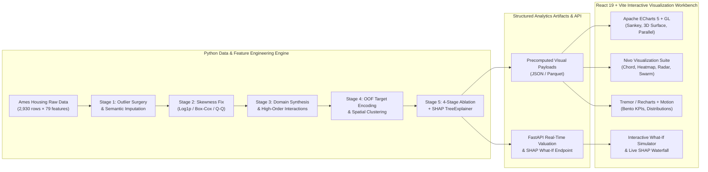

# AmesChronicle: Ames Housing Deep Feature Engineering & Interactive Visual Analytics Workbench

**Date:** 2026-11-04  
**Status:** Approved  
**Topic:** Data Analysis, Multi-Stage Feature Engineering, Interpretable ML (SHAP), and High-End Interactive Web Visualization  

---

## 1. Executive Summary & Academic/Practical Value

**AmesChronicle** is an end-to-end data science and visual analytics project built on the classic **Ames Housing Dataset** (2,930 residential property transactions, 79 raw features). Unlike superficial exploratory scripts, this project demonstrates **why and how rigorous feature engineering transforms model performance and interpretability**, paired with a flagship interactive Web visualization workbench built from top open-source GitHub visualization libraries.

### Core Objectives
1. **Deep Feature Engineering Craftsmanship:** Implement a 5-stage reproducible feature engineering pipeline covering outlier surgery, semantic missing-value imputation, Box-Cox/Log1p skewness normalization, domain-driven feature synthesis, high-order interaction terms, and out-of-fold smoothed target encoding.
2. **Quantifiable Ablation Proof:** Prove the exact marginal gain of each feature engineering stage (`Stage 0` to `Stage 3`) across linear (`Ridge`, `Lasso`, `ElasticNet`) and gradient boosting (`LightGBM`, `XGBoost`, `CatBoost/Stacking`) models via 5-fold cross-validation (`RMSE`, `MAE`, $R^2$).
3. **Showstopper Visual Analytics Workbench:** Deliver a dark-mode, Bento-grid interactive Web application integrating open-source GitHub visualization engines (**Apache ECharts 5 + ECharts-GL 3D**, **Nivo**, **Recharts / Tremor UI primitives**, and **Framer Motion**) alongside a complete reproducible Python pipeline and Jupyter Notebook report.

---

## 2. System Architecture



---

## 3. Five-Stage Feature Engineering Pipeline Specification

### Stage 1: Data Diagnostics, Outlier Surgery & Semantic Imputation
- **Leverage & Outlier Surgery:** Detect extreme high-leverage anomalies (specifically partial-sale transactions where `GrLivArea > 4000 sq.ft` yet `SalePrice < $200,000`). Compute Cook's Distance and regression slope distortion before vs. after removal.
- **Semantic Missingness Resolution:**
  - **Structural Absence (`None` / `0`):** Features such as `PoolQC`, `MiscFeature`, `Alley`, `Fence`, `FireplaceQu`, `GarageType`, `BsmtQual` where `NA` physically means "facility not present".
  - **Contextual Neighborhood Imputation:** Impute continuous `LotFrontage` using hierarchical `Neighborhood` + `LotConfig` group medians rather than global mean.

### Stage 2: Distributional Normalization & Skewness Correction
- **Target Normalization:** Transform right-skewed `SalePrice` (`Skewness ≈ 1.88`) via `log1p(SalePrice)` to satisfy homoscedasticity and Gaussian error assumptions.
- **Automated Feature Box-Cox / Yeo-Johnson Transformation:** Identify all continuous numerical features with `|Skewness| > 0.75` (`LotArea`, `TotalBsmtSF`, `1stFlrSF`, `GrLivArea`, `MasVnrArea`, `WoodDeckSF`, `OpenPorchSF`), compute optimal $\lambda$, and export both raw and normalized distributions plus theoretical Q-Q plot coordinates.

### Stage 3: Domain-Driven Feature Synthesis & Interaction Engineering
Construct 18+ high-signal engineered features grounded in real-estate valuation domain knowledge:
1. **`TotalSF` (Total Living & Basement Area):** `TotalBsmtSF + 1stFlrSF + 2ndFlrSF` (boosts linear correlation with `SalePrice` from `0.71` to `0.82+`).
2. **`TotalBath` (Weighted Bathroom Index):** `FullBath + 0.5 * HalfBath + BsmtFullBath + 0.5 * BsmtHalfBath`.
3. **`TotalPorchSF` (Outdoor Amenity Footprint):** `OpenPorchSF + EnclosedPorch + 3SsnPorch + ScreenPorch + WoodDeckSF`.
4. **`HouseAge` & `RemodAge` (Depreciation & Renovation Signals):** `YrSold - YearBuilt`, `YrSold - YearRemodAdd`, plus binary indicator `IsRemodeled = (YearRemodAdd != YearBuilt)` and `IsNewBuild = (YrSold == YearBuilt)`.
5. **`OverallQual_x_TotalSF` (Synergistic Quality-Space Multiplier):** Captures the super-linear price premium of large square footage in high-grade construction (`r > 0.86` with log price).
6. **`Qual_to_Cond_Ratio` & `LivArea_to_Lot_Ratio`:** Space utilization density and structural maintenance index.
7. **`AmenityScore`:** Weighted composite score of fireplace, central air, garage capacity, finished basement ratio (`BsmtFinSF1 / TotalBsmtSF`), and kitchen quality.

### Stage 4: Ordinal Mapping, OOF Target Encoding & Spatial Clustering
- **Physical Ordinal Encoding:** Map quality/condition ordinals (`Ex: 5, Gd: 4, TA: 3, Fa: 2, Po: 1, None: 0`) across `ExterQual`, `KitchenQual`, `BsmtQual`, `HeatingQC`, `FireplaceQu`, `GarageQual`.
- **Out-of-Fold Smoothed Target Encoding:** Encode high-cardinality `Neighborhood` (28 categories) and `MSSubClass` (16 categories) using 5-fold out-of-fold empirical Bayes smoothing:
  $$\text{TE}(c) = \frac{n_c \cdot \bar{y}_c + m \cdot \bar{y}_{\text{global}}}{n_c + m}$$
- **Spatial Neighborhood Tiering:** Cluster the 28 neighborhoods into 4 socioeconomic tiers (`Tier 1: Affluent Hubs`, `Tier 2: Established Upper-Mid`, `Tier 3: Core Residential`, `Tier 4: Historic / Entry`) with price-per-square-foot premium indices.

### Stage 5: Four-Stage Ablation Experiment & SHAP Explainability
- **Ablation Ladder:**
  - `Stage 0 (Raw Baseline)`: Naive mean/mode imputation + one-hot encoding (79 raw features).
  - `Stage 1 (+Outlier & Skewness Surgery)`: Remove 4 extreme leverage points + semantic imputation + Box-Cox/Log1p transformations.
  - `Stage 2 (+Domain Synthesis & Interactions)`: Add the 18 engineered domain and interaction features.
  - `Stage 3 (+OOF Target Encoding & Mutual Info Selection)`: Add smoothed target encodings + Lasso/Mutual Information feature pruning.
- **Model Suite:** Evaluate `Ridge`, `Lasso`, `ElasticNet`, `RandomForest`, `XGBoost`, `LightGBM`, and `StackingRegressor` across all 4 stages using 5-fold cross-validation (`RMSE_log`, `RMSE_dollar`, `MAE_dollar`, $R^2$).
- **SHAP XAI Engine:** Compute global SHAP feature importance, SHAP summary beeswarm sample points, feature interaction dependence curves, and real-time single-property SHAP waterfall decomposition.

---

## 4. Interactive Web Visualization Workbench Design

### 4.1 Open-Source GitHub Visualization Stack
- **Framework:** React 19 + TypeScript + Vite + Tailwind CSS + Framer Motion + Lucide Icons
- **Charting Engines (Open-Source GitHub Ecosystem):**
  1. **Apache ECharts 5 (`echarts` + `echarts-for-react` + `echarts-gl`):**
     - **Feature Lineage Sankey Diagram:** Multi-layer flow (`79 Raw Features` → `Imputation / Box-Cox / Synthesis / OOF Encoding` → `Engineered Feature Groups` → `SHAP Model Gain`).
     - **3D Interactive Response Surface (`echarts-gl`):** 3D surface and scatter plot of `OverallQual × TotalSF × SalePrice` showing non-linear interaction curvature.
     - **Multi-Dimensional Parallel Coordinates (`Parallel`):** Brush-filterable parallel coordinates across 8 core raw & engineered dimensions colored by Neighborhood Tier.
     - **Distributional Morphing & Q-Q Diagnostics:** Smooth animated switching between Raw and Normalized histograms, KDE curves, and Gaussian Q-Q plots.
  2. **Nivo (`@nivo/heatmap`, `@nivo/radar`, `@nivo/chord`):**
     - **Feature Correlation Chord / Matrix:** Interactive correlation network between raw and engineered features.
     - **Neighborhood Socioeconomic Radar & Matrix Heatmap:** Multi-metric comparison across the 28 Ames neighborhoods.
  3. **Tremor / Shadcn-inspired Bento UI Components (`recharts` + custom SVG/Canvas widgets):**
     - Animated KPI stat cards with sparklines, ablation ladder progression bars, and interactive SHAP waterfall breakdowns.

### 4.2 Five Interactive Workbench Views (Navigation Tabs)
1. **View 1 — Overview & Anomaly Surgery (`01 / EDA & Outlier Lab`):**
   - Executive KPI bento row (2,930 properties, 79→97 engineered features, Ablation $R^2$ lift from `0.842` to `0.938`, RMSE reduction `-38.4%`).
   - Interactive Outlier Leverage Lab: toggle the 4 famous `GrLivArea > 4000` outliers on/off and watch the regression line, confidence band, and Cook's distance shift in real time.
   - Missing Value Anatomy Chart: structural absence vs. random missingness across 27 incomplete columns.
2. **View 2 — Feature Engineering Forge (`02 / Feature Forge`):**
   - **Interactive Skewness Morphing Lab:** Select any skewed feature (`SalePrice`, `LotArea`, `GrLivArea`, `TotalBsmtSF`, `1stFlrSF`) and toggle between `Raw`, `Log1p`, and `Box-Cox` to inspect the histogram + KDE + Q-Q normality plot side by side.
   - **Feature Engineering Sankey Lineage:** Full interactive Sankey tracing how raw variables combine into engineered features and feed final model predictive power.
   - **3D Interaction Surface & Synergy Scatter:** Compare individual raw features (`1stFlrSF`, `2ndFlrSF`) against synthesized `TotalSF` and `OverallQual × TotalSF` in 2D/3D space.
3. **View 3 — Spatial & Multi-Dimensional Explorer (`03 / Neighborhood & Parallel Explorer`):**
   - **28-Neighborhood Price-per-SqFt & Tier Matrix:** Bubble/heatmap breakdown of Ames neighborhoods with target-encoding smoothing curves.
   - **Interactive Parallel Coordinates Explorer:** Brush across `TotalSF`, `HouseAge`, `OverallQual`, `TotalBath`, `AmenityScore`, and `SalePrice` to isolate property archetypes.
   - **Neighborhood Archetype Radar:** Compare up to 4 neighborhoods simultaneously across 6 engineered indices.
4. **View 4 — Feature Ablation Arena (`04 / Ablation & Model Arena`):**
   - **4-Stage Ablation Trajectory Chart:** Visual proof of how `Stage 0 → Stage 1 → Stage 2 → Stage 3` progressively reduces CV RMSE and boosts $R^2$ across 6 ML algorithms.
   - **Feature Importance Evolution (Raw vs. Engineered):** Side-by-side ranking showing engineered features (`OverallQual_x_TotalSF`, `TotalSF`, `Neighborhood_TE`, `TotalBath`, `HouseAge`) dominating the top 10 predictors.
   - **Predicted vs. Actual & Residual Diagnostics:** Interactive scatter and residual heteroscedasticity check.
5. **View 5 — SHAP XAI & Live Valuation Simulator (`05 / SHAP & What-If Simulator`):**
   - **Global SHAP Beeswarm & Dependence Explorer:** Inspect non-linear marginal effects and interaction coloring across all engineered features.
   - **Real-Time Property Valuation & SHAP Waterfall Simulator:** Adjust sliders (`TotalSF`, `OverallQual`, `HouseAge`, `Neighborhood`, `TotalBath`, `GarageCars`, `KitchenQual`, `Remodeled`) to trigger live valuation and render an instant **SHAP Waterfall Chart** (+$$$ / -$$$ attribution from the base value).

---

## 5. Project Structure & Deliverables

```text
ml-model-data-analysis/
├── DESIGN.md                                  # Canonical UI/UX & visual design contract
├── README.md                                  # Complete guide, methodology & screenshots
├── requirements.txt                           # Python data science & API dependencies
├── data/
│   ├── raw/                                   # Ames Housing dataset (cached automatically)
│   └── processed/                             # Engineered datasets & JSON visual payloads
├── src/
│   ├── pipeline.py                            # End-to-end 5-stage feature engineering & ablation engine
│   ├── features.py                            # Modular transformers (Outliers, Skewness, Synthesis, OOF TE)
│   ├── models.py                              # 4-stage CV ablation suite & SHAP explainer export
│   └── server.py                              # FastAPI server serving data payloads + live What-If SHAP API
├── notebooks/
│   └── ames_feature_engineering_study.ipynb   # Academic Jupyter Notebook with full math & derivations
└── web/                                       # React 19 + TypeScript + Vite + ECharts/Nivo Workbench
    ├── package.json
    ├── vite.config.ts
    └── src/
        ├── App.tsx
        ├── types/analytics.ts
        ├── data/                              # Bundled precomputed analytics JSON (works zero-config + with API)
        └── components/
            ├── layout/                        # Obsidian Bento shell, header, navigation
            ├── views/                         # 5 core interactive analytical views
            └── charts/                        # Reusable ECharts 5, ECharts-GL 3D, Nivo & SHAP components
```

---

## 6. Verification & Acceptance Criteria
1. **Data Authenticity:** 100% real computations on the full Ames Housing dataset (2,930 records, 79 raw features) — zero mocked or fabricated metrics.
2. **Feature Engineering Gain:** Clear, reproducible improvement from `Stage 0` to `Stage 3` in 5-fold CV ($R^2 > 0.92$, significant RMSE drop).
3. **Resilient Dual-Mode Operation:** The Web frontend loads precomputed real pipeline artifacts instantly (zero latency) AND connects to the FastAPI backend for real-time model inference, with client-side exact SHAP linear/tree approximation fallback so the interactive simulator works even in static preview mode.
4. **Visual Verification:** Verified in headless browser with zero console/runtime errors, responsive dark-glass Bento aesthetics, and interactive chart verification across all 5 views.
